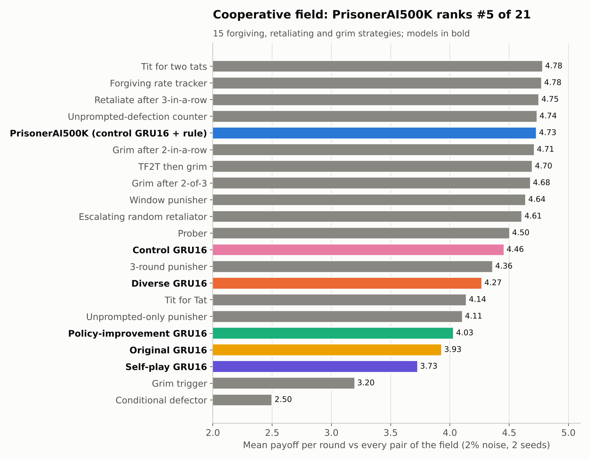
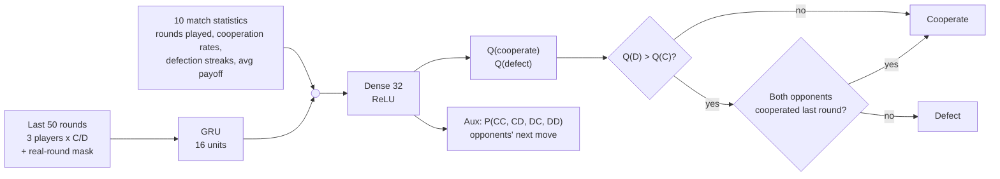
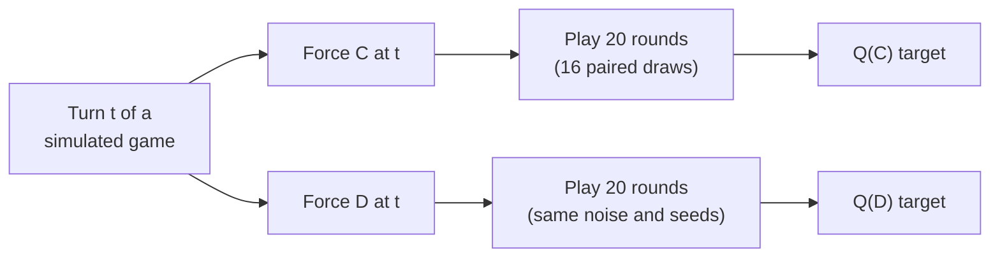
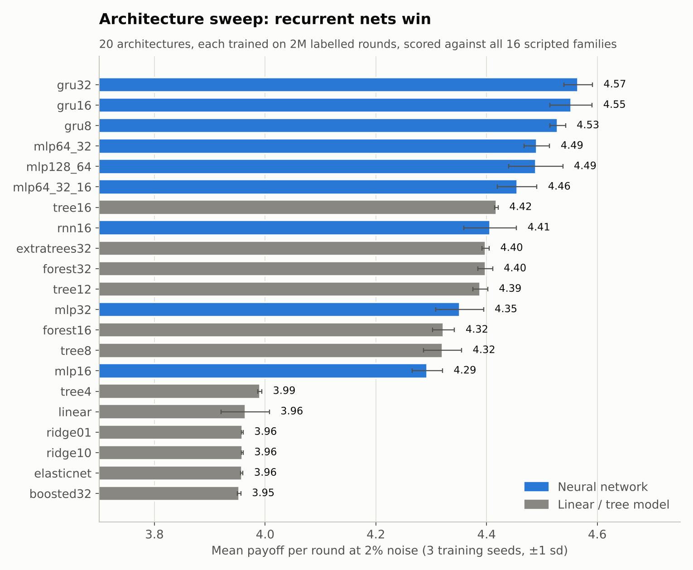
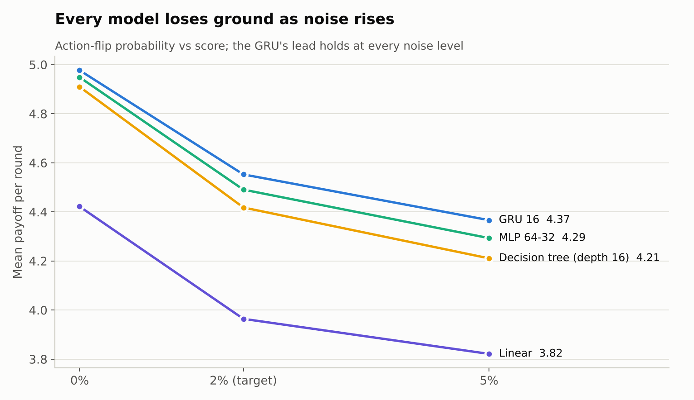
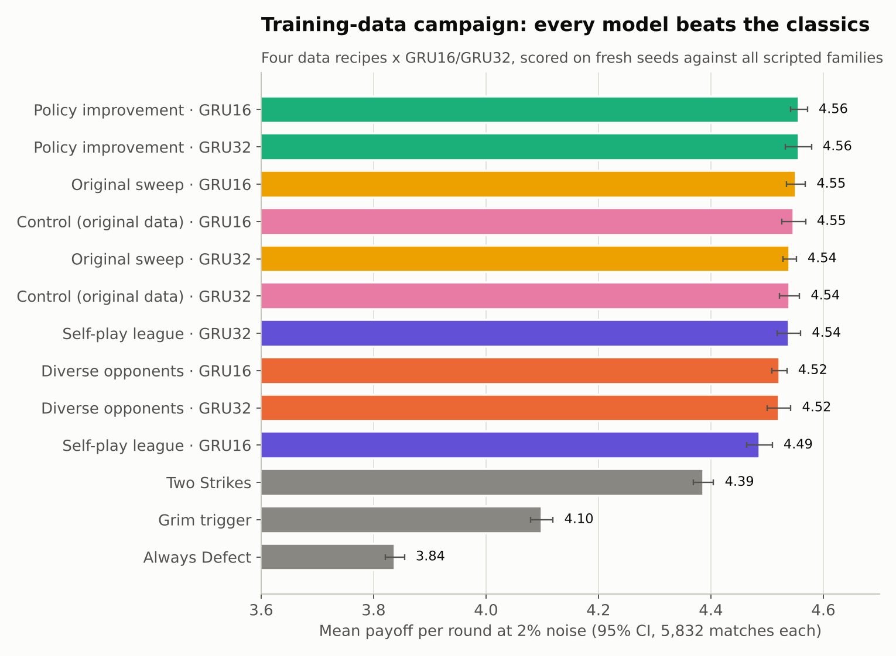
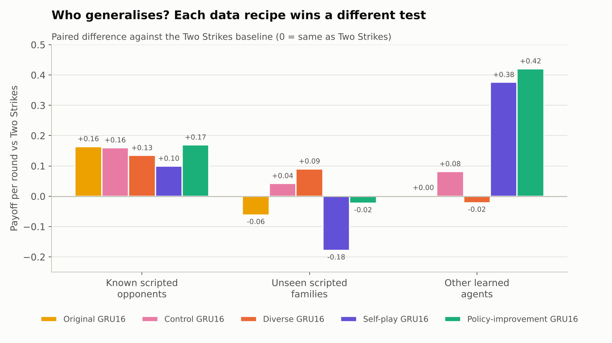
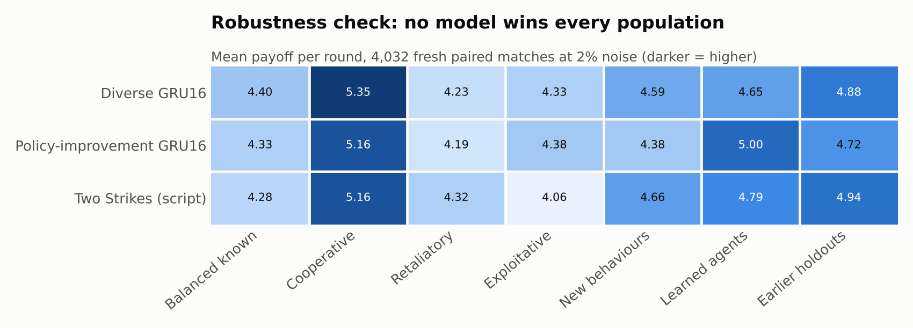
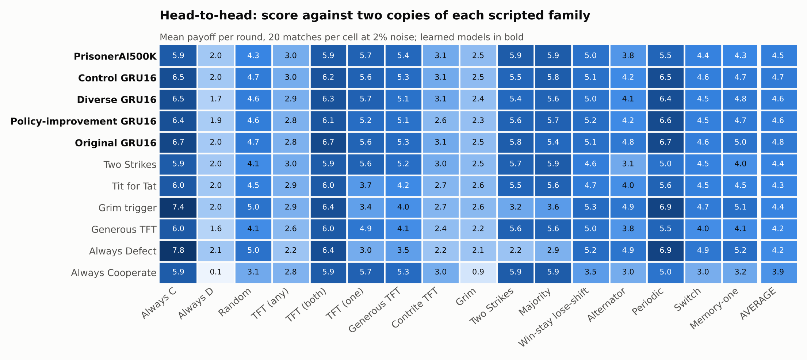
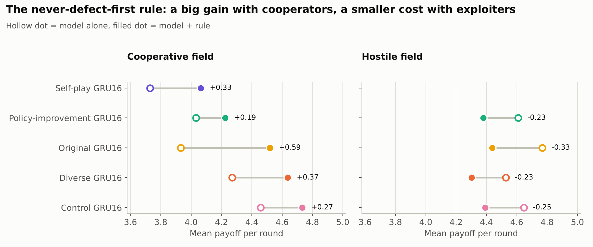

<div align="center">

# 3-Player Prisoner's Dilemma · AI Agents

**Small recurrent networks that learn when to cooperate in a noisy, three-player repeated Prisoner's Dilemma**

2,118-parameter GRU agents · trained on millions of simulated games · pure-Python inference in ~6 ms per move

[Results at a glance](#results-at-a-glance) · [Model zoo](#model-zoo) · [How it works](#how-it-works) · [Experiments](#experiments) · [Reproduce](#reproduce)

</div>

---

## The game

Three players choose **Cooperate (C)** or **Defect (D)** every round for a match of unknown length (normal around 100 rounds). Each move has a **2% chance of being flipped** by a noisy channel.

| My move | Both others C | One other D | Both others D |
|:---:|:---:|:---:|:---:|
| **C** | 6 | 3 | 0 |
| **D** | 8 | 5 | 2 |

Defecting always pays exactly **+2 this round**, but every defecting opponent costs **−3**. So cooperation only survives if opponents punish defection, and noise makes it hard to tell punishment from accidents. Agents are scored by their average payoff per round.

---

## Results at a glance

<picture>
  <source media="(prefers-color-scheme: dark)" srcset="docs/figures/cooperative_field-dark.png">
  
</picture>

| | Finding |
|:---:|---|
| 🧠 | **Recurrent nets beat everything else.** Across 20 architectures, GRUs scored highest (4.55-4.57 per round at 2% noise) and linear models lowest (3.96). |
| 📈 | **Every learned model beats the classic strategies** on the scripted benchmark: 4.49-4.56 per round vs 4.39 for Two Strikes, 4.10 for Grim Trigger and 3.84 for Always Defect. |
| 🎯 | **The training data decides what a model is good at.** Policy-improvement data gave +0.42 over Two Strikes against other learned agents; diverse-opponent data was best on unseen strategies. |
| 🤝 | **One 3-line rule fixed the biggest weakness.** "Never defect first" lifted every model by +0.19 to +0.59 against forgiving retaliators, turning the control GRU into **PrisonerAI500K**: the best learned agent there (#5 of 21). |
| ⚖️ | **No single agent wins every field.** Against hostile, exploitative opponents the raw models do better, and the rule costs about 0.25 per round. |

---

## Model zoo

All weights are in this repo: **[`models/weights/`](models/weights)** (pure-Python JSON, about 43 KB each) and **[`models/checkpoints/`](models/checkpoints)** (PyTorch `state_dict`, 13 KB each). Every model is a 16-unit GRU with 2,118 parameters.

| Model | Training data | Cooperative field | Hostile field | Strengths | Weaknesses |
|---|---|:---:|:---:|---|---|
| ⭐ **PrisonerAI500K**<br>`control_gru16` + rule | 500k rounds, 16 scripted families | **4.73** | 4.39 | Best learned agent against forgiving retaliators; never starts a grudge; 2.0 vs Always Defect | Never exploits pushovers (5.9 vs Always Cooperate, where Always Defect gets 7.8) |
| **Control GRU16**<br>`control_gru16` | Same as above | 4.46 | 4.65 | Strong all-rounder on known strategies (4.55); near the top of the hostile field | Starts defecting around rounds 60-80, which retaliators punish for the rest of the match |
| **Diverse GRU16**<br>`diverse_gru16` | +5 extra strategy families | 4.27 | 4.53 | Best on unseen strategies (+0.09 vs Two Strikes) and cooperative populations (5.35) | Weakest vs Always Defect (1.6) because it keeps offering cooperation |
| **Policy-improvement GRU16**<br>`policy_improvement_gru16` | Rollouts continued by a frozen model league | 4.03 | 4.61 | Top known-strategy score (4.56); +0.42 vs other learned agents; best vs exploiters | Slightly below Two Strikes on unseen strategies; too aggressive among forgiving opponents |
| **Original GRU16**<br>`original_gru16` | 2M rounds, first sweep | 3.93 | **4.77** | Wins the hostile field outright, beating Always Defect and Grim Trigger | Most aggressive model: the worst choice among cooperators |

<sub>Cooperative field = 15 forgiving, retaliating and grim rule-based strategies; hostile field = 10 exploitative or unforgiving strategies. Both at 2% noise, mean payoff per round.</sub>

```python
import sys; sys.path.insert(0, "models")
from gru_agent import GRUAgent

agent = GRUAgent("control_gru16", never_defect_first=True)    # = PrisonerAI500K
agent.play([0, 0], [0, 1], [0, 0])   # my history, opponent 1, opponent 2 -> 0 = cooperate
```

---

## How it works

### The agent



- **Value model, not a policy.** The network estimates the payoff of cooperating and of defecting *right now*, and the agent picks the larger.
- **Auxiliary head.** Predicting the opponents' next joint move forces the hidden state to model them; the decision ignores these outputs.
- **Seat symmetry.** Every prediction is averaged with the prediction for the two opponents swapped, so seat order never changes a decision.
- **Never defect first** (PrisonerAI500K only): a 3-line guard on top of the model.
- **No ML libraries at inference.** The forward pass is plain Python + `math` and takes about 6 ms per move.

### The training labels

Each label comes from a **paired Monte Carlo rollout**. At a sampled turn the game is copied into a *cooperate-now* branch and a *defect-now* branch, and both are played forward up to 20 rounds with the same noise and opponent randomness. The average payoffs become the targets for Q(C) and Q(D), so the model learns the **long-term cost of defecting** (retaliation) rather than the +2 it pays immediately.



| Dataset | Games | Labelled rounds | Opponents |
|---|---:|---:|---|
| Original | 3.59 M | 28.7 M | 16 scripted families (Tit for Tat variants, Grim, Two Strikes, Win-Stay-Lose-Shift, Majority, Memory-one, random, periodic, ...) |
| Diverse | 0.70 M | 5.6 M | the 16 above + 5 new families (forgiving majority, finite punisher, gradual retaliator, soft reciprocator, opportunist) |
| Self-play | 0.30 M | 2.4 M | half scripted, half frozen copies of earlier GRU/MLP models |
| Policy improvement | 0.14 M | 1.1 M | as self-play, with rollouts continued by the frozen models instead of a fixed rule |

Match lengths follow a normal distribution (mean 100, sd 10, truncated to 80-200 rounds) with 2% action noise, the target setting.

---

## Experiments

### 1. Which architecture? Recurrent nets win

<picture>
  <source media="(prefers-color-scheme: dark)" srcset="docs/figures/architecture_sweep-dark.png">
  
</picture>

Twenty model types were trained on the same 2M labelled rounds (3 seeds each) and played against all 16 scripted families. **GRUs top the table**, MLPs follow, and tree ensembles plateau around 4.40 (boosted trees lag far behind). Linear models can't represent "punish only repeated defection" and land near 3.96. A GRU with just 8 units already beats every non-recurrent model.

<picture>
  <source media="(prefers-color-scheme: dark)" srcset="docs/figures/noise_sensitivity-dark.png">
  
</picture>

Noise hurts everyone (about −0.4 from 0% to 2%), but the ranking never changes.

### 2. Which training data? Every recipe beats the classics

<picture>
  <source media="(prefers-color-scheme: dark)" srcset="docs/figures/campaign_leaderboard-dark.png">
  
</picture>

Four data recipes × two sizes × two seeds were trained with an **equal 500k-round budget** so differences come from the data, not its amount. All ten finalists clear Two Strikes by 0.10-0.17 per round (95% CIs exclude zero), and the gaps between learned models are small.

<picture>
  <source media="(prefers-color-scheme: dark)" srcset="docs/figures/generalisation-dark.png">
  
</picture>

The differences show up **off the training distribution**:

- **Against other learned agents**, self-play and policy-improvement data dominate (+0.38 / +0.42).
- **Against scripted families never seen in training**, diverse data is best (+0.09), and self-play is worst (−0.18).

### 3. Stress-testing by population

<picture>
  <source media="(prefers-color-scheme: dark)" srcset="docs/figures/robustness_populations-dark.png">
  
</picture>

A pre-declared check with 4,032 fresh paired matches confirmed it: **no agent wins every population.** Diverse GRU16 leads with cooperators, policy-improvement leads with exploiters and learned agents, and plain Two Strikes is still best against strict retaliators and brand-new behaviours.

<picture>
  <source media="(prefers-color-scheme: dark)" srcset="docs/figures/family_heatmap-dark.png">
  
</picture>

Head-to-head against two copies of each family, **every learned model out-averages every classic strategy** (4.54-4.80 vs at most 4.38). Grim Trigger and Always Defect only shine where they can farm unconditional cooperators. The never-defect-first rule costs PrisonerAI500K about 0.16 here, almost all of it from no longer exploiting Always Cooperate (6.46 → 5.92).

### 4. A cooperative field and the never-defect-first rule

The models above were tuned on scripted opponents. Many hand-written strategies for this game are forgiving retaliators, so I built a field of 15 such rules (forgiving retaliators, a few grim triggers and one mostly-defecting agent) plus a hostile field of 10 exploitative or unforgiving ones. The cooperative-field ranking is the figure at the top of the page.

The raw models placed mid-table. Traces showed why: they **start defecting around rounds 60-80**, expecting a small end-game gain, and forgiving-but-firm opponents punish that for the rest of the match. Adding one rule (cooperate whenever both opponents cooperated last round) fixed it:

<picture>
  <source media="(prefers-color-scheme: dark)" srcset="docs/figures/guard_effect-dark.png">
  
</picture>

| | Cooperative field | Hostile field |
|---|:---:|:---:|
| Effect of the rule | **+0.19 to +0.59** | −0.23 to −0.33 |
| Best agent | Tit for two tats (4.78) | Original GRU16 (4.77) |
| PrisonerAI500K | 4.73 (#5 of 21, best learned) | 4.39 |

Compared with Diverse GRU16, PrisonerAI500K gains **+0.46** in the cooperative field and gives up only **0.13** in the hostile one, so the rule is the better bet whenever most opponents reciprocate.

---

## Lessons learned

1. **Recurrence matters.** Even 8 GRU units beat every feed-forward and tree model; the order of past moves carries signal that summary statistics miss.
2. **Rollout labels teach consequences.** Paired cooperate/defect futures let a model learn retaliation from data, but a 20-round horizon and a fixed continuation policy still under-price grudges that last the rest of the match.
3. **Benchmarks reward the training distribution.** The best model on scripted families (policy improvement) was among the worst in the cooperative field. Test against the population you will actually meet.
4. **Simple rules and learned values combine well.** A 3-line safeguard on top of the model beat retraining for the same problem.

---

## Repository layout

```
├── models/
│   ├── gru_agent.py           pure-Python inference (load any weights by name)
│   ├── PrisonerAI500K.py      single-file, self-contained version of the best agent
│   ├── weights/*.json         model weights (JSON, no ML libraries needed)
│   └── checkpoints/*.pt       PyTorch state_dicts
├── pipeline/
│   ├── generate_training_data.py   game simulator + paired-rollout labels
│   ├── experiment_data.py          dataset sharding and caching
│   ├── model_training.py           GRU / RNN / MLP definitions (PyTorch)
│   ├── classical_training.py       linear and tree baselines (scikit-learn)
│   ├── run_model_experiments.py    train, export and benchmark the architecture sweep
│   ├── agent_export.py             export a trained model to a standalone .py agent
│   ├── benchmark_agents.py         paired benchmark vs scripted families
│   ├── campaign_policies.py        extra families + frozen-league opponents
│   ├── generate_campaign_lane.py   data generation for the data-recipe campaign
│   ├── run_campaign.py             end-to-end campaign: generate, train, screen, evaluate
│   ├── robustness_check.py         pre-declared population stress test
│   └── test_*.py                   unit tests
├── evaluation/
│   ├── opponents.py           cooperative and hostile strategy fields
│   └── tournaments.py         stress tournaments and per-family head-to-heads
├── results/                   every number in this README, as CSV / JSONL
├── scripts/make_figures.py    regenerates all figures (light + dark)
└── docs/figures/
```

## Reproduce

```bash
pip install -r requirements.txt            # numpy, torch, scikit-learn, matplotlib

# 1. Generate labelled games (CPU-heavy; Ctrl+C to stop, rerun to resume)
cd pipeline
python generate_training_data.py --output training_data --episodes 100000

# 2. Train and benchmark the architecture sweep (GPU recommended)
python run_model_experiments.py --suite large --data training_data

# 3. Stress tournaments for the released models (pure Python, no GPU)
cd ..
python evaluation/tournaments.py cooperative --agents gru:control_gru16:guard gru:diverse_gru16
python evaluation/tournaments.py hostile     --agents gru:control_gru16:guard gru:original_gru16
python evaluation/tournaments.py families    --agents gru:control_gru16:guard script:two_strikes

# 4. Rebuild every figure
python scripts/make_figures.py
```

`pipeline/prison.py` defines the payoff table and the `Player` interface every agent implements.

## Limitations

- All opponents are simulated and hand-written; real opponents may behave differently.
- Scores are means over finite schedules; differences under about 0.05 per round are within noise unless a confidence interval is shown.
- Q-value targets come from a 20-round horizon and a fixed continuation policy, so they are not optimal action values.
